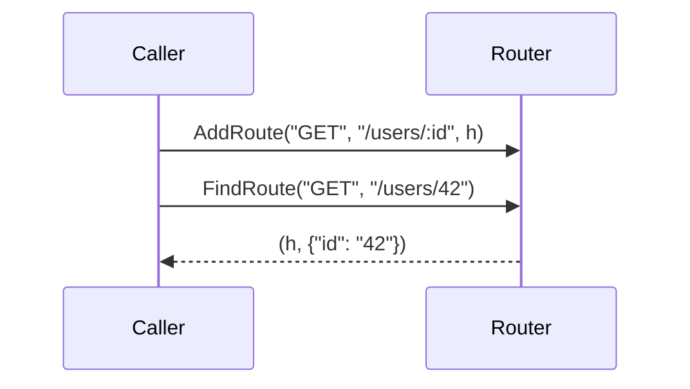

# 源码导读：HTTP 路由匹配与优先级设计

## Part 1: 写前导读（Pre-Lab · 契约与边界）

### 调用生命周期

### 对外契约与入口：`router.go:8-27`
- `Handler` 接收标准 `http.ResponseWriter`、`*http.Request` 以及解析后的路径参数 `map[string]string`。
- `Router` 对外只暴露 `NewRouter`、`AddRoute`、`FindRoute` 三个契约方法，调用方不关心内部采用线性表还是前缀树。

### 方法签名与空值约定：`router.go:29-59`
- 忽略空的 `method`、`path` 或 `nil` handler。
- `FindRoute` 未命中时返回 `(nil, nil)`，静态路由应优先于同位置参数路由。

---

## Part 2: 提交后深读（Post-Submit · 核心实现剖析）

> 在 `challenge` 模式下，本部分于 `/promentor review` 阶段解锁。

### 分树与节点结构：`router.go:11-22`
- `trees map[string]*node` 按 HTTP Method 拆分独立根节点，避免不同方法之间的路径冲突，同时减少每次查找的分支数。
- 每个 `node` 预先计算 `isParam` 和 `paramKey`，把字符串前缀解析前置到注册期而非每次请求热路径。

### 静态优先与回溯清理：`router.go:78-103`
- `matchNode` 先遍历非参数子节点，全部未命中再尝试参数子节点，天然满足“静态段 > 参数段”优先级。
- 参数分支递归失败时执行 `delete(params, child.paramKey)`，防止失败分支把脏参数残留到最终结果中。
