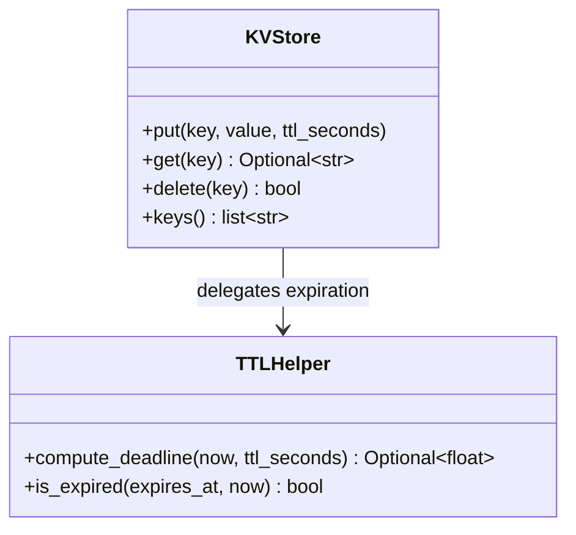

# Ch 1: 内存键值存储与惰性 TTL 淘汰

本章拆解内存键值引擎如何用确定性时钟实现 TTL（Time-To-Live）过期淘汰，同时将过期判断逻辑与存储字典解耦。

## 1. 模块关系

## 2. 设计权衡：惰性淘汰 vs 后台定时扫描

- **惰性淘汰**：在 `get` / `delete` / `keys` 访问时检查是否过期，零后台线程开销，易于确定性测试。
- **后台定时器**：可更早回收长期无人访问的过期键，但需要锁与后台调度复杂度。

## 3. 本章 Lab 目标

本章为多文件 Lab，请实现 `ttl.py` 与 `store.py` 两个骨架文件：
- `ttl.py`：提供 `compute_deadline` 与 `is_expired`；
- `store.py`：实现支持注入 `clock` 的 `KVStore`。
