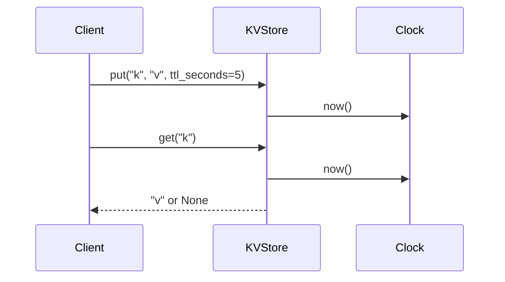

# 源码导读：内存键值存储与惰性 TTL 淘汰

## Part 1: 写前导读（Pre-Lab · 契约与边界）

### 调用流程

### 对外契约：`kv.py:9-23`
- `KVStore` 接受可注入的无参时钟函数 `clock`，默认使用单调时钟 `time.monotonic`。
- 空 `key` 必须抛出 `ValueError`；`ttl_seconds <= 0` 时键立即失效（不可读取）。

---

## Part 2: 提交后深读（Post-Submit · 核心实现剖析）

> 在 `challenge` 模式下，本部分于 `/promentor review` 阶段解锁。

### 单调时钟与惰性清理：`kv.py:25-49`
- 选用 `time.monotonic` 而非 `time.time`，避免系统校时导致的时钟回拨。
- `get` 与 `delete` 在发现键已过期时同步执行 `pop` 并返回未命中语义（`None` / `False`），保持行为一致性。
- `keys()` 先收集全部过期键再统一删除，避免在迭代字典期间修改字典引发 `RuntimeError`。
