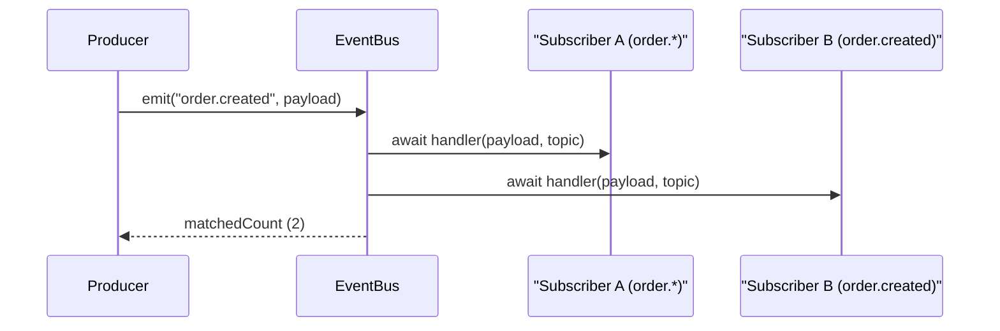

# Ch 1: 异步事件总线与通配符主题匹配

本章剖析事件驱动架构中最核心的解耦枢纽 `EventBus`，聚焦主题通配符匹配与异步派发期间的迭代安全性。

## 1. 事件派发流程

## 2. 关键工程陷阱：派发期取消订阅

如果 `SubA` 在自己的回调函数中调用了 `unsubscribe()` 删除自身，而 `EventBus` 直接在原数组上用下标循环，会导致 `SubB` 左移一位而被跳过！思考如何通过快照语义消除这一经典陷阱。

## 3. 本章 Lab 目标

在 `event_bus.ts` 骨架中实现 `matchTopic` 与 `EventBus`（`on` / `emit`）：
- 支持点分主题精确匹配与单段 `*` 通配符；
- 空主题/空模式抛出错误；
- 回调内取消订阅不影响本轮其余已匹配订阅者的执行。
