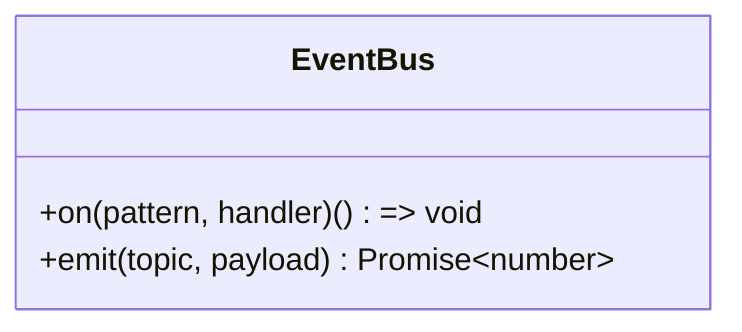

# 源码导读：异步事件总线与通配符主题匹配

## Part 1: 写前导读（Pre-Lab · 契约与边界）

### 核心类型关系

### 对外接口契约：`src/event_bus.ts:1-25`
- `on(pattern, handler)` 注册订阅并返回一个幂等的取消订阅函数。
- `emit(topic, payload)` 按注册顺序依次 `await` 匹配的处理器，并返回本轮触发的处理器数量。

---

## Part 2: 提交后深读（Post-Submit · 核心实现剖析）

> 在 `challenge` 模式下，本部分于 `/promentor review` 阶段解锁。

### 派发快照与安全退订：`src/event_bus.ts:27-37`
- `emit` 先通过 `filter` 生成匹配订阅的快照数组，再顺序 `await`，彻底避免回调中 `splice` 修改原数组导致的迭代跳项。
- 取消函数使用对象引用 `indexOf(sub)` 定位，天然支持同一函数多次注册且重复调用退订安全幂等。

### 分段匹配：`src/event_bus.ts:40-47`
- 按 `.` 拆分为等长段数组并逐段检查 `part === "*" || part === tParts[i]`，避免拼接正则表达式带来的 ReDoS 与转义隐患。
