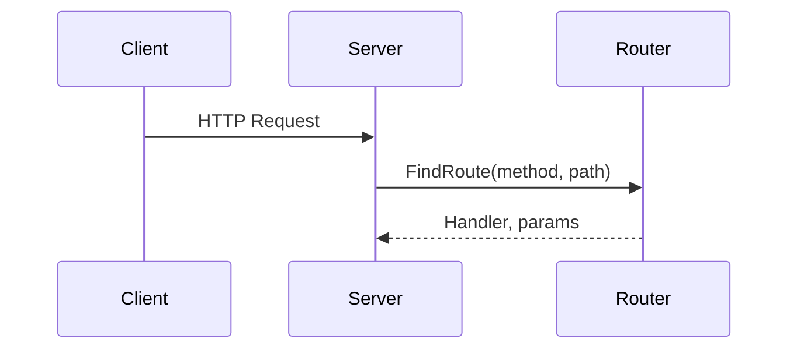

# `.promentor/` 数据格式规范

> 读写 `course.json`、`progress.json`、`lab.json` 及章节 Markdown 产物时的完整字段规范。示例语言仅作演示，规则本身与项目语言无关。

## 目录

- [1.1 目录结构](#11-目录结构)
- [1.2 章节 ID 与简写匹配](#12-章节-id-与简写匹配)
- [1.3 course.json](#13-coursejson)
- [1.4 progress.json 与统一评分模型](#14-progressjson-与统一评分模型)
- [1.5 lab.json](#15-labjson)
- [1.6 lecture.md 规范](#16-lecturemd-规范)
- [1.7 source.md 规范（两阶段防剧透）](#17-sourcemd-规范两阶段防剧透)
- [1.8 review_{N}.md 规范](#18-review_nmd-规范)

---

## 1.1 目录结构

所有课程数据以纯文本存储于目标项目根目录的 `.promentor/` 下，人类可读、易于 diff；在 Git 仓库内通过 `.git/info/exclude` 忽略（不修改目标仓库已跟踪的 `.gitignore`；仅非 Git 目录回退写入 `.gitignore`）：

```text
.promentor/
├── course.json                    # 课程元信息、Commit 锚点与生成状态
├── progress.json                  # 学习进度、成绩与提示层级
├── main.<ext>                     # （可选，仅 Final 组装章）课程可运行入口
├── chapters/
│   ├── ch01-<slug>/
│   │   ├── lecture.md             # 概念与设计决策讲义（≤ 300 行，含 Mermaid）
│   │   ├── source.md              # 两阶段源码导读（Part 1 写前 + Part 2 提交后）
│   │   ├── lab.json               # Lab 接口、测试命令、校验和与补充说明
│   │   ├── <starter_file>.<ext>   # 骨架代码（学生直接在此文件实现）
│   │   └── <test_file>            # 分层行为测试（只读，学生不可改）
│   └── ch02-<slug>/
└── submissions/
    └── ch01-<slug>/
        ├── attempt_1/             # 第 1 次提交归档目录（完整复制 lab.json files）
        │   └── <student_file>.<ext>
        ├── review_1.md            # 第 1 次提交的对比 Review 报告
        ├── attempt_2/             # （可选）二次重构后的第 2 次提交归档目录
        │   └── <student_file>.<ext>
        └── review_2.md            # （可选）增量对比 Review 报告
```

---

## 1.2 章节 ID 与简写匹配

### 合法章节 ID 格式

章节 ID 必须匹配正则：`^(ch[0-9]{2}|final)-[a-z0-9]+(-[a-z0-9]+)*$`

| 类别 | 格式示例 | 用途 |
| --- | --- | --- |
| 导论/环境章（可选） | `ch00-setup` | 环境配置、最小可运行骨架或基础概念热身 |
| 核心模块章 | `ch01-http-server`、`ch02-router` | 课程主体，按依赖拓扑顺序递增编号 |
| 组装终章（可选） | `final-mini-gin` | 将前置章节组件组装为可运行系统 |

### `/promentor learn <arg>` 简写匹配规则

按以下优先级匹配 `course.json` 中的 `chapters[].id`：

1. **精确匹配**：`<arg>` 等于某个 `id`（如 `ch02-router`、`final-mini-gin`）。
2. **前缀/序号匹配**：
   - `ch0` / `ch00` / `0` → 匹配 `ch00-*`
   - `ch2` / `ch02` / `02` / `2` → 匹配 `ch02-*`
   - `final` → 匹配 `final-*`
3. **Slug 匹配**：`<arg>` 匹配 `*-<arg>` 或包含 `-<arg>` 的唯一章节（如 `router` → `ch02-router`）。
4. **冲突/未命中**：匹配 0 个或多个时，列出候选章节请用户明确选择。

---

## 1.3 course.json

```json
{
  "schema_version": "0.7.0",
  "project": "gin",
  "language": "go",
  "mode": "challenge",
  "focus": null,
  "generation_mode": "lazy",
  "source_commit": "a1b2c3d4e5f6789012345678901234567890abcd",
  "generated_at": "2026-11-20T10:00:00Z",
  "chapters": [
    {
      "id": "ch01-http-server",
      "title": "HTTP Server 基础",
      "summary": "理解 net/http Server 的生命周期与 Handler 抽象",
      "difficulty": "mid",
      "generation_status": "generated",
      "prerequisites": [],
      "learning_goals": [
        "理解 net/http Server 的生命周期",
        "掌握 Handler 接口的设计意图"
      ],
      "source_files": ["gin.go:1-120"],
      "lab_interface": {
        "package": "httpserver",
        "exports": ["NewServer", "Server.ServeHTTP"]
      }
    },
    {
      "id": "ch02-router",
      "title": "Router 设计",
      "summary": "实现支持路径参数与优先级匹配的路由器",
      "difficulty": "hard",
      "generation_status": "pending",
      "prerequisites": ["ch01-http-server"],
      "learning_goals": [
        "对比静态 Map 与前缀树路由的权衡",
        "处理参数段与通配符匹配优先级"
      ],
      "source_files": ["tree.go:1-180"],
      "lab_interface": {
        "package": "router",
        "exports": ["NewRouter", "Router.AddRoute", "Router.FindRoute"]
      }
    }
  ]
}
```

### 字段说明

| 字段 | 类型 | 必填 | 说明 |
| --- | --- | --- | --- |
| `schema_version` | `string` | 推荐 | 课程数据格式版本（当前 `"0.7.0"`） |
| `project` | `string` | 是 | 项目名称（与 `progress.json` 保持完全一致的键名 `project`） |
| `language` | `string` | 是 | 主语言标识，如 `go`、`python`、`typescript`、`javascript`、`rust`、`java`、`c`、`cpp` |
| `mode` | `string` | 是 | `"challenge"`（默认，写前防剧透，提交后解锁深读）\| `"guided"`（写前允许完整阅读源码） |
| `focus` | `string \| null` | 是 | `--focus` 聚焦的子系统/主题；全项目课程为 `null` |
| `generation_mode` | `string` | 是 | `"lazy"`（默认按需逐章生成）\| `"all"`（`init --all` 全量生成） |
| `source_commit` | `string` | 是 | 初始化时 `git rev-parse HEAD` 的完整 SHA；非 Git 仓库置为 `""` |
| `generated_at` | `string` | 是 | ISO-8601 UTC 时间戳 |
| `chapters[].id` | `string` | 是 | 合法章节 ID（见 §1.2） |
| `chapters[].title` | `string` | 是 | 章节标题 |
| `chapters[].summary` | `string` | 是 | 一句话简介，供大纲与课程面板展示 |
| `chapters[].difficulty` | `string` | 是 | `"easy"` \| `"mid"` \| `"hard"` |
| `chapters[].generation_status` | `string` | 是 | `"pending"`（未生成）\| `"in_progress"`（生成中）\| `"generated"`（已生成并通过 Red-State 自检） |
| `chapters[].prerequisites` | `string[]` | 是 | 前置章节 `id` 列表，禁止循环依赖 |
| `chapters[].learning_goals` | `string[]` | 是 | 本章学习目标列表 |
| `chapters[].source_files` | `string[]` | 是 | 原始项目关键源码文件与行号，推荐格式 `"path/to/file:start-end"`（1-based 闭区间） |
| `chapters[].lab_interface` | `object` | 是 | `{ "package": string, "exports": string[] }` |

---

## 1.4 progress.json 与统一评分模型

```json
{
  "project": "gin",
  "current_chapter": "ch02-router",
  "chapters": {
    "ch01-http-server": {
      "status": "completed",
      "score": 100,
      "attempts": 1,
      "hint_level_reached": 1,
      "completed_at": "2026-11-20T15:04:05Z",
      "last_submitted_at": "2026-11-20T15:04:05Z"
    },
    "ch02-router": {
      "status": "in_progress",
      "score": 60,
      "attempts": 0,
      "hint_level_reached": 2
    },
    "ch03-middleware": {
      "status": "not_started",
      "score": 0,
      "attempts": 0,
      "hint_level_reached": 0
    }
  }
}
```

### 字段说明

| 字段 | 类型 | 说明 |
| --- | --- | --- |
| `project` | `string` | 项目名称（统一为 `project`，不使用 `project_name`） |
| `current_chapter` | `string \| null` | 当前正在学习的章节 `id`；尚未开始时为 `null` |
| `chapters[id].status` | `string` | `"not_started"` \| `"in_progress"` \| `"completed"` |
| `chapters[id].score` | `number` | `0`–`100` 整数，严格遵循下方统一评分模型 |
| `chapters[id].attempts` | `number` | 成功通过 `/promentor submit` 归档的次数（初始为 `0`） |
| `chapters[id].hint_level_reached` | `number` | 本章达到的最高提示层级（`0` \| `1` \| `2` \| `3`），独立记录不扣分 |
| `chapters[id].completed_at` | `string` | 首次 `submit` 成功时的 ISO-8601 UTC 时间戳（未完成时省略） |
| `chapters[id].last_submitted_at` | `string` | 最近一次 `submit` 归档时间（支持二次重构提交，未提交时省略） |

### 统一评分与进度计算规则

1. **测试阶段（`/promentor test`）**：
   - 未全部通过时，计算当前通过率 `floor(passed / total * 100)`（范围 `0`–`99`，即使四舍五入接近 100 也不得显示 `100`），并更新 `in_progress` 章节的 `score`。
   - 若全部通过但尚未执行 `/promentor submit`，提示 `100%（待提交）`，不提前标记为 `completed`；若章节原本已是 `completed`（如二次重构中），保持 `status: "completed"` 与 `score: 100`。
2. **提交阶段（`/promentor submit`）**：
   - 仅当**全部行为测试通过（`passed == total`）且测试文件 SHA-256 校验通过**时允许提交。
   - 提交成功后，`status` 置为 `"completed"`，`score` 锁定为 `100`，`attempts` 递增 `1`。
   - **Hint 不扣分**：`hint_level_reached` 单独展示，用于复盘独立完成度，避免出现“全过却得分 88%”的规则矛盾。
3. **总体进度计算（`/promentor` 与 `/promentor progress`）**：
   - `overall_percent = round(completed_count / total_chapters * 100)`
   - 示例：共 5 章、完成 2 章 → `Overall: 2/5 chapters · 40% complete`。

---

## 1.5 lab.json

```json
{
  "chapter_id": "ch02-router",
  "title": "Router 设计",
  "description": "实现一个支持路径参数和 HTTP 方法匹配的路由器",
  "language": "go",
  "package": "router",
  "files": [
    {
      "path": "router.go",
      "description": "路由器的核心实现"
    }
  ],
  "starter_files": [
    "router.go"
  ],
  "test_file": "lab_test.go",
  "test_checksum": "sha256:e3b0c44298fc1c149afbf4c8996fb92427ae41e4649b934ca495991b7852b855",
  "interface": {
    "types": [
      {
        "name": "Router",
        "kind": "struct",
        "doc": "HTTP 路由器，存储路由表并提供查找"
      },
      {
        "name": "Handler",
        "kind": "type",
        "doc": "type Handler func(w http.ResponseWriter, req *http.Request)"
      }
    ],
    "functions": [
      {
        "signature": "func NewRouter() *Router",
        "doc": "创建一个新的 Router 实例"
      },
      {
        "signature": "func (r *Router) AddRoute(method, path string, handler Handler)",
        "doc": "注册一个路由规则。path 可包含 :param 参数段"
      },
      {
        "signature": "func (r *Router) FindRoute(method, path string) (Handler, map[string]string)",
        "doc": "查找匹配的路由。返回 handler 和路径参数。无匹配时 handler 为 nil"
      }
    ]
  },
  "test_command": "cd {chapter_dir} && go test -v .",
  "notes": [
    "中间件链将在 Ch 3 实现，本章 Handler 仅处理单次请求。",
    "扩展挑战：首次提交并通过 Review 后，尝试用 Radix Tree 重构 router.go 并重新提交。"
  ]
}
```

### 字段说明

| 字段 | 类型 | 必填 | 说明 |
| --- | --- | --- | --- |
| `chapter_id` | `string` | 是 | 与 `course.json` 对应章节 `id` 一致 |
| `title` | `string` | 是 | Lab 标题 |
| `description` | `string` | 是 | 一句话描述要实现的核心能力 |
| `language` | `string` | 是 | 本章语言标识 |
| `package` | `string` | 是 | 包名 / 模块名 / 命名空间 |
| `files` | `Array<{path, description}>` | 是 | 学生需实现的文件清单（相对 `{chapter_dir}`）。`init` 按此生成骨架，`submit` 按此完整复制到 `attempt_{N}/` |
| `starter_files` | `string[]` | 推荐 | 章节生成时创建的全部骨架与脚手架文件清单（至少包含 `files[].path`，若包含独立 `Cargo.toml`、`package.json` 等一并列出），供 `--resume` 完整性校验 |
| `test_file` | `string` | 是 | 行为测试文件相对路径（如 `lab_test.go`、`test_lab.py`、`lab_test.ts`；TS/JS 禁止 `*.test.*` / `*.spec.*`） |
| `test_checksum` | `string` | 是 | `test_file` 的 SHA-256 校验和，格式 `sha256:<64位小写十六进制>`；在生成期 Red-State 自检通过后写入，`submit` 前必须核验 |
| `interface.types` | `Array<{name, kind, doc}>` | 是 | 需导出的核心类型清单（无独立类型时可为空数组 `[]`） |
| `interface.functions` | `Array<{signature, doc}>` | 是 | 学生必须严格遵循的函数/方法签名清单 |
| `test_command` | `string` | 是 | 从项目根目录执行的测试命令，支持 `{chapter_dir}` 占位符（替换为 `.promentor/chapters/{chapter_id}`） |
| `notes` | `string[]` | 可选 | 补充说明：跨章暂缺依赖的占位约定、Final 章运行命令、扩展重构挑战等（兼容旧版单字符串，推荐数组） |

---

## 1.6 lecture.md 规范

讲义为纯文本 Markdown，写作要求：

1. **开门见山**：首段说清“本章学什么、它在系统中的位置、为什么重要”。
2. **核心概念拆解**：每个核心概念一小节，聚焦问题定义与抽象边界；**在 `challenge` 模式下不得直接贴出待实现核心算法的完整实现代码**。
3. **设计决策与权衡**：对比至少两种可选方案，解释原项目选择当前方案的工程 Tradeoff。
4. **Mermaid 可视化**：至少包含 1 个零构建 Mermaid 图表（架构关系用 `flowchart`、生命周期用 `sequenceDiagram`、类型关系用 `classDiagram`）。含括号或特殊字符的节点标签加双引号，不使用 HTML 标签。
5. **衔接 Lab**：结尾明确指向本章骨架文件与需要实现的核心契约。
6. **篇幅控制**：单章讲义 **≤ 300 行**。

---

## 1.7 source.md 规范（两阶段防剧透）

源码导读固定划分为两个阶段，确保 `challenge` 模式下不提前剧透，同时在 `review` 阶段可解锁完整行级剖析：

```markdown
# 源码导读：Router 设计

## Part 1: 写前导读（Pre-Lab · 契约与边界）

### 模块协作关系



### 外部接口与入口：`router.go:1-32`
- 说明对外暴露的 `Router` 契约、方法签名与调用方预期。
- 说明本模块依赖哪些输入、产生哪些输出，不展开内部查找算法细节。

---

## Part 2: 提交后深读（Post-Submit · 核心实现剖析）

> 本部分在 `challenge` 模式下于 `/promentor review` 阶段解锁。

### 核心数据结构：`tree.go:18-54`
- 解释为何选用压缩前缀树（Radix Tree）而非 `map[string]Handler`。

### 路由查找与回溯：`tree.go:88-145`
- 逐段标注关键行号，解释静态段 > 参数段 > 通配符的优先级实现与工程权衡。
```

### 写作要求

- 必须包含 `## Part 1:`（写前导读）和 `## Part 2:`（提交后深读）两个顶级分段。
- 所有源码行号引用必须使用真实存在的 `relative/path:start-end`（1-based，且 `1 <= start <= end <= 文件总行数`）。
- Part 1 只讲接口契约、调用入口与系统边界，不泄露待实现模块的核心算法实现。
- Part 2 聚焦“为什么这样设计”而非逐行翻译代码。

---

## 1.8 review_{N}.md 规范

每次执行 `/promentor review` 时，自动落盘至 `.promentor/submissions/{chapter_id}/review_{N}.md`（`N` 与本次评审对应的 `attempt_{N}` 编号一致）：

```markdown
# Code Review：ch02-router（Attempt #1）

- **评审时间**：2026-11-20T16:10:00Z
- **对应提交**：`.promentor/submissions/ch02-router/attempt_1/`
- **参考源码**：`tree.go:18-145`（commit `a1b2c3d`）

## 1. 五维对比分析
| 维度 | 你的实现 | 原始设计 | 关键权衡 |
| --- | --- | --- | --- |
| 功能正确性 | ... | ... | ... |
| 数据结构选择 | ... | ... | ... |
| 算法效率 | ... | ... | ... |
| 边界处理 | ... | ... | ... |
| 扩展性 | ... | ... | ... |

## 2. 优点与可改进点
- **优点**：...
- **不足与风险**：...

## 3. 提交后源码深读（Part 2 解锁）
- 结合 `source.md` Part 2 与原始代码关键行剖析设计决策。

## 4. 演进对比（仅 Attempt #2+ 必填）
- 对比 `attempt_{N-1}` 与 `attempt_{N}` 在数据结构、复杂度与边界处理上的具体进步。

## 5. 重构挑战（Challenge）
- 给出 1 个具体、可落地的优化方向，鼓励重构后再次 `/promentor submit` 与 `/promentor review`。
```
